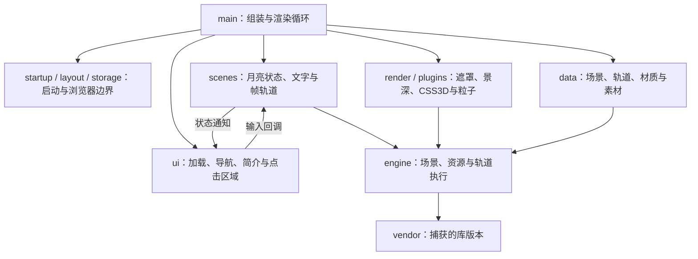

# 模块职责与复用

这里描述「空月之歌」开场和月亮首屏的运行代码。原站回放与旧 `demo/`、`replica/` 实验不参与新页面运行。



场景控制器决定“接下来播放什么”，渲染器执行“这一帧如何采样和绘制”，UI 接收状态并回传输入。图片、GLSL、Spine 和关键帧是独立数据。`main.mjs` 有页面副作用，复用其他模块时无需导入它。

## 运行模块

| 入口                                                                                                 | 职责与依赖                                                               | 复用入口 / 约束                                                                                                                                                    |
| ---------------------------------------------------------------------------------------------------- | ------------------------------------------------------------------------ | ------------------------------------------------------------------------------------------------------------------------------------------------------------------ |
| [`main.mjs`](../app/main.mjs)                                                                        | 加载字体/数据，创建播放器、插件、场景和 UI，连接音效与 RAF               | 页面入口；`window.__moonApp` 供验收观察实际对象，不作为通用组件 API                                                                                                |
| [`startup.mjs`](../app/startup.mjs)、[`layout.mjs`](../app/layout.mjs)                               | 加载层淡出与开场；区分设计画幅、CSS 尺寸与 DPR                           | `loadFont(url, dependencies)`、`OpeningFlow.start()`；纯函数 `measureViewport()`、浏览器适配 `applyViewport(player)`                                               |
| [`storage.mjs`](../app/storage.mjs)、[`errors.mjs`](../app/errors.mjs)                               | 可选存档和启动失败后的重试入口                                           | `getProgressStorage({ getStorage, resetKey })` 允许注入存储；`showInitializationError()` 用于资源/WebGL 初始化失败                                                 |
| [`data/index.mjs`](../app/data/index.mjs)                                                            | 读取具名 JSON 与 GLSL，按类型标记创建 Three 材质                         | `loadSceneData({ THREE, utils, fetch })`；不传 `THREE` 时返回原始材质配置。`createShaderSetting()` 可独立使用；字段见 [`data/README.md`](../app/data/README.md)    |
| [`scenes/moon.js`](../app/scenes/moon.js)                                                            | 开场、两段文字、滚轮、四个故事和已读引导；依赖场景节点、文字、音效、存储 | `MoonSceneController` 注入 `delay`、计时器、随机数、`onState`；`createMoonSceneClass(THREE, services)` 连接场景生命周期。节点/轨道名属于这份场景的协议             |
| [`scenes/timeline.js`](../app/scenes/timeline.js)、[`scenes/text.js`](../app/scenes/text.js)         | 帧轨道 Promise 适配；粒子文字进入、退出、可见状态                        | `FrameTimelinePlayer.play(name, options)` 透传选项；`ParticleTextController.show(text, options)` 防止进入/退出重叠。文本依赖粒子节点                               |
| [`render/modifiers.mjs`](../app/render/modifiers.mjs)、[`render/css3d.mjs`](../app/render/css3d.mjs) | 重建合成、轨道绑定、程序运动、遮罩、景深与 CSS3D                         | `createModifiers({ getFrame, schedule })` 返回六种适配器，调用时以场景对象作为 `this`；`createCSS3DModifier({ getFrame })` 和矩阵转 CSS 函数可独立使用             |
| [`engine/plugins.js`](../app/engine/plugins.js)                                                      | 贝塞尔粒子、文字点阵与景深/星体几何；依赖 Three 与渲染工具               | `createPlugins({ translate, getLanguage, isMobile })` 显式注入语言/设备；粒子缓冲与 shader 属性须配套                                                              |
| [`engine/index.js`](../app/engine/index.js)、[`engine/renderer/`](../app/engine/renderer/)           | 场景实例、资源、摄像机、帧轨道与渲染通道                                 | 从 `index.js` 导入 `THREEPlayer`、`motion`、`richText`、`msdf`、`utils` 等；`getScene()` 会延迟创建场景，不只是查询                                                |
| [`ui.mjs`](../app/ui.mjs)、[`ui.css`](../app/ui.css)                                                 | 自己的 DOM/CSS：加载、顶部、提示、简介、音频与四个点击区域               | `createUI(callbacks)` 返回 `setLoading`、`setState`、`setAudio`、`attachHotspots`、`showRules`、`hideLoading`、`destroy`；需要 `#page-ui`、`#canvas-bg` 与配套 CSS |
| [`local-assets/`](../app/local-assets/)、[`ui-assets/`](../app/ui-assets/)                           | 原二进制素材和从原 UI 恢复的图形                                         | 保留像素、字体与音频；README 记录来源。`data/textures`、`spines`、`shaders` 存内嵌纹理、Spine 配置和原 GLSL                                                        |

例如，布局计算可以脱离 DOM/WebGL 使用：

```js
import { measureViewport } from "./app/layout.mjs";
const frame = measureViewport({ width: 1200, height: 660, pixelRatio: 2 });
// frameWidth = 660 * 2500 / 1080；renderSize = { width: 2400, height: 1320 }
```

场景数据通过构造器依赖加载：

```js
import { THREE, utils } from "./app/engine/index.js";
import { loadSceneData } from "./app/data/index.mjs";
const data = await loadSceneData({ THREE, utils });
// layoutData、timelineSetting、shaderSetting 等提供给播放器配置。
```

上例从仓库根目录的 ES 模块执行；数据由 `import.meta.url` 定位，需要 HTTP 服务。复用 UI 时，把 `onStar(index)` 接到控制器的 `clickStar(index)`，把控制器 `onState` 接到 `ui.setState(state)`，场景初始化后调用 `ui.attachHotspots(player)`。`onRulesChange(true/false)` 在简介打开开始/关闭开始通知宿主，用于暂停/恢复场景绘制。

## 恢复核心与库的边界

新写的启动、场景控制器、UI、粒子插件和渲染适配器拥有明确的依赖入口。`renderer/` 是从捕获渲染包恢复出的 59 个静态 ES 模块。资源、场景与 motion 是需要维护的自定义渲染核心；文件名和 import 已拆开，不代表内部语义重构已经全部完成。

| 核心组     | 关系 / 必须保留的语义                                                                                                                                                                  |
| ---------- | -------------------------------------------------------------------------------------------------------------------------------------------------------------------------------------- |
| 场景与资源 | `three-player` 组装场景、节点与通道；`source-loader` 管理图源和进度；相机、scene-data、render-passes 负责配置转换与绘制支持                                                            |
| 帧轨道     | `motion.createTimeline()` 按 `type` 创建 Group、Keyframe、Tween、Spine、Step、Skin、Texture、Movie、Gradient；`createBlock()` 创建片段。Group 与 motion 有依赖环，实例创建保留在运行时 |
| 采样与片段 | Base 管理父级帧偏移，Group 驱动 GSAP/cue，Keyframe 用相邻整帧插值，Tween/其他子类采样片段并写目标。帧端点、取模、权重混合顺序和 easing 是数据协议                                      |
| 文字       | rich-text 解析、布局、测量、绘制；msdf 处理距离场字形。测量值进入粒子/纹理，不可用视觉近似替代                                                                                         |
| Spine      | `spine-runtime.js` 混合 Spine 运行时、Three 适配与自定义自动骨骼运动，整文件不能视作纯第三方发行包                                                                                     |

`vendor/` 保留捕获的 Three、GSAP、CustomEase、Howler、浏览器检测和 regenerator，`libraries.js` 提供导入适配。捕获的 Three 带 `tick` / `afterRender` 扩展，替换为同版本官方包也须验证事件与渲染行为。模块 ID、源包 SHA256 和版本说明见 [`PROVENANCE.md`](../app/engine/PROVENANCE.md) 与 `extraction.json`；捕获工厂未保留可见原版权/许可头，来源记录不能代替原许可文本。

`three-player`、`source-loader`、`base-timeline`、`motion`、`engine-api`、`scene-data` 是已整理的维护入口。播放器使用原生类和语义名称，加载器使用原生 async；Base 保留派生构造器的 `.call()` 兼容性。其他恢复模块仍有编译形态，不宜把整个目录当作已完成语义重构。

`npm run extract` 用于恢复对照：引擎默认原始输出写入 `artifacts/reference-engine`，场景数据仍写入 `app/data`。提取器在首次写入前检查每个目标文件，禁止覆盖 `app/engine`，包括嵌套目录/文件的符号链接。生成器恢复模块边界，维护源码的语义整理不由生成器自动完成。完整分析过程见 [reverse-engineering.md](reverse-engineering.md)。

## 跨模块不变量

1. **字体先于缓存。** `loadFont()` 完成后才初始化文字节点；错误字体产生的首次纹理会被缓存，晚加载字体不能自动修正。
2. **CSS 与物理像素分开。** 画幅按高度缩放，CSS3D 宽高是视口 CSS 尺寸，WebGL 渲染尺寸才乘 DPR。把宽画幅传给 CSS3D 会重复裁切偏移。
3. **时钟各司其职。** 原轨道默认以 30 fps 换算帧数；简介打开/页面隐藏时跳过场景 tick/render，RAF、DOM 与 GSAP 继续。关闭简介开始即恢复场景，输入隔离保持到 180 ms 退出结束。
4. **DOM 出生时刻也是动效。** 顶部、开始提示、引导与弹窗的初始类需要独立 style flush；双 RAF 保留原动画起点。重开弹窗后，旧延时不能再隐藏新弹窗或恢复旧焦点。
5. **加载文字与图形精度不同。** 数字向下取整，SVG 扇形保留浮点进度；保留 Text 节点并跳过未变属性，避免合成层无必要失效。加载 DOM 挂到加载 CSS3D 节点，父合成层淡出后以 `duration: 0` 移除。
6. **算法顺序也是结果。** 遮罩、离屏缓冲、景深通道、typed array 写入和 easing 数值不可在可读性重构中顺便改动；先写行为对照，再改名称或控制结构。

## 工具与验证

| 命令 / 工具                           | 验证或输出什么                                                                                                                |
| ------------------------------------- | ----------------------------------------------------------------------------------------------------------------------------- |
| `npm test`、`npm run test:core`         | 全部回归 / 不依赖捕获目录的维护代码回归；不能证明整页像素或真实时钟一致                                                        |
| `npm run verify:engine`               | 原工厂与适配器的粒子缓冲、文字 RGBA、运动、CSS3D；遮罩与景深仅模拟 renderer 调用轨迹                                          |
| `npm run verify:visual`               | 双视口指定时刻整页默认 GPU 截图、轨道/时钟与严格像素差；`artifacts/reconstruction`                                            |
| `npm run verify:introduction`         | 简介打开前、进入、停留、退出的双视口整页对照；`artifacts/introduction`                                                        |
| `npm run verify:browser`              | 真实时钟的开始、滚轮、四热点、故事关闭、音频、简介暂停/恢复，以及请求/控制台错误                                              |
| `npm run verify:ui`、`verify:startup` | 简介键盘隔离/重入与 UI 时点；启动/字体失败路径                                                                                |
| `npm run extract`                     | 从本地捕获包恢复原始引擎对照与场景数据，需要 `projects/ys.mihoyo.com`                                                         |
| `npm run pack:assets`、`build`        | 按捕获映射打包二进制；复制运行文件至 `dist`、调整 URL 前缀。`build:pages` 使用仓库子路径，见 [`deployment.md`](deployment.md) |
| `npm run start:reference`、`replay/`  | 原站捕获回放，仅作为验收参考，不参与新页面运行依赖                                                                            |

先启动 `npm start` 再跑浏览器检查；整页对照还需要原站回放/捕获资源。`RECONSTRUCTION_URL`、`BROWSER_MODULES`、`CHROME_PATH` 指定页面与浏览器环境，按 [README](../README.md) 设置。仅打包和运行新页面不需要捕获目录。

修改 UI 先跑 UI/真实交互，修改轨道或材质先跑逻辑与引擎对照，再跑整页时点检查。底层测试、原站回放与整页检查提供不同证据；有限视口和时刻不能推广为所有设备与任意动画时刻的一致性。当前验收、残留像素差与范围见 [`phase-one.md`](phase-one.md)；登录、分享服务、移动端和后续章节尚未重建。
