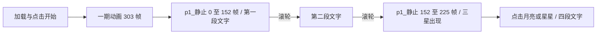

# 空月之歌：开场与月亮首屏

## 范围与实现

目标为 https://ys.mihoyo.com/moon 的加载页、开场、两段引导文字、月亮与三颗星星，
包括点击月亮和星星出现的四段文字、原字体、声音、滚轮推进和鼠标效果。

原版动画的结构是：

原站把场景父子关系、Shader、材质、Spine、图集和关键帧都打包在 JS 中。
`replay/` 保留这些数据及运行时，仅在 HTTP 响应中替换资源地址，将 Webpack
动态路径、国际化 JSON 和字体路径映射到下载资源。图片、字体、音频不做二次加工。
相比自行重建 Three.js 场景，这可以直接保留每个帧的布局、遮罩、颜色和缓动。

`resource-map.js` 读取下载清单，按完整 URL 优先替换，再处理动态域名前缀。
`server.js` 用原生 HTTP 提供资源和媒体范围请求。`bootstrap.js` 处理本地请求、
初次访问进度及第一阶段边界。`h5log.js` 使用原账号 SDK 的空日志回退接口。
原资源文件保持原样；旧 Demo 保留供参考。

`native-patches.js` 只为原版匿名启动时未捕获的 Promise 添加窄范围处理：
消费缓存接口明确返回的活动结束错误 `-500012`，其余错误继续抛出。
后台活动结束状态保持原样，场景和动画不受影响。

## 时间与文字

原生时间轴默认 30 FPS。开场 303 帧，名义 10.1 秒；随后 152 帧约 5.067 秒。
第一段文字在后者第 60 帧触发，文字粒子 40 帧、速度 0.75，名义约 1.778 秒。
两次滚轮推进后，73 帧约 2.433 秒让三颗星星出现。
原版在低帧率时限制 delta 为 0.03 秒，因此实际墙钟时间会随机器性能变化。
保留该行为，而不是给本地版本添加额外的 CSS 时长或加速。
这些数值是各条时间轴自身的时长，不包含加载页淡出、章节切换或用户阅读停留。

从原中文国际化资源直接读取：

- 曾牵引着原初的天球， / 为一整个世界带来爱与热忱的三月女神早已逝去
- 但追逐着潮汐的人们并未停止欢歌与祈祷， / 因为新的月神将要重临…
- 当「恒月」陨落，天地为之翻覆
- 当「虹月」破碎，赤影隐入渊海
- 当「霜月」停转，列邦归于沉沦
- 不再为「永恒」庇护的世界正走向终末， / 直到「新月」初升，牵动起命运的纺轮…

实际标点、换行和排版均由原 JSON 与字体绘制，上述斜线只是文档中的换行说明。

## 验证方式与边界

HTTP 测试覆盖 URL 替换顺序、JSON 转义、动态资源、字体、纹理字节一致、视频范围、
未知资源、进度重置、日志接口与阶段边界。

`scripts/verify-visual.cjs` 在同一 Chrome 中打开两个隔离会话。参考会话运行未经修改的
已捕获 HTML、JS、CSS、JSON 和素材，保留原始域名；对照会话访问本地重写版本。
只在测试中固定随机种子、Date.now、performance.now 与 RAF，以 60 Hz 同步推进。
测试钩子在 `initPlayer` 前包装原粒子插件，按每个发射器 UUID 分配种子，避开 SDK
与加载顺序消耗随机数的干扰。两份原 Howler 的零时长淡入淡出在冻结时钟下会计算
`0/0`，测试只将该情况改成异步完成并发送原 `fade` 事件，保留正常音频回调顺序。
CSS 动画也按相同时间定位。所有钩子仅在验证浏览器内存在；磁盘参考源文件未经修改。
采集加载、开场各阶段、两段文字、三星与四段点击文字，输出逐像素差值和原生时间轴状态。
这验证本地化是否改变画面或帧序列，不等同于不同 GPU、浏览器或原站未来版本间的像素保证。
加载页允许最高一个色阶的 GPU 舍入差异；其它检查点要求零像素差异。

首屏正常交互也需在真实时钟下检查，确保字体已加载、WebGL 动画可播放、浏览器没有缺失资源。
`verify:browser` 实际点击原 CSS3D 的四个目标并在画布上关闭弹层，确认全部访问状态，
再滚动确认停留月亮页。`verify:live` 核对入口、全部视觉包、中文文案与字体、四张纹理；
若入口仅 SEO/分享/版权/标题/图标元数据变化可单独标注，viewport、charset、CSP 等仍判不同。
原账号、领取奖励及后续章节不在此阶段范围内。测试使用缓存的匿名接口响应。

## 本次验证记录

- 15 项自动测试通过。
- 当前线上 12 个关键源文件与下载资源 SHA256 全部一致。
- 1200×660 / DPR 1 与 1920×1080 / DPR 2，各 12 个检查点，共 24 帧：零像素差异，
  包含加载页；所有记录的动画帧数、文字状态、画布尺寸和布局矩形一致。
- 正常时钟下，实际鼠标依次点击三颗星星与月亮，四段弹层均成功打开与关闭，
  四个访问状态均更新；随后滚动仍停留月亮页。没有浏览器异常、失败或缺失资源。
- 逐像素报告：`artifacts/visual/report.json`；线上核对：`artifacts/live-source.json`；
  真实鼠标交互报告：`artifacts/browser-smoke.json`。

报告和截图由验证脚本生成，不提交大型图片到 Git。运行服务器后可重新生成。
