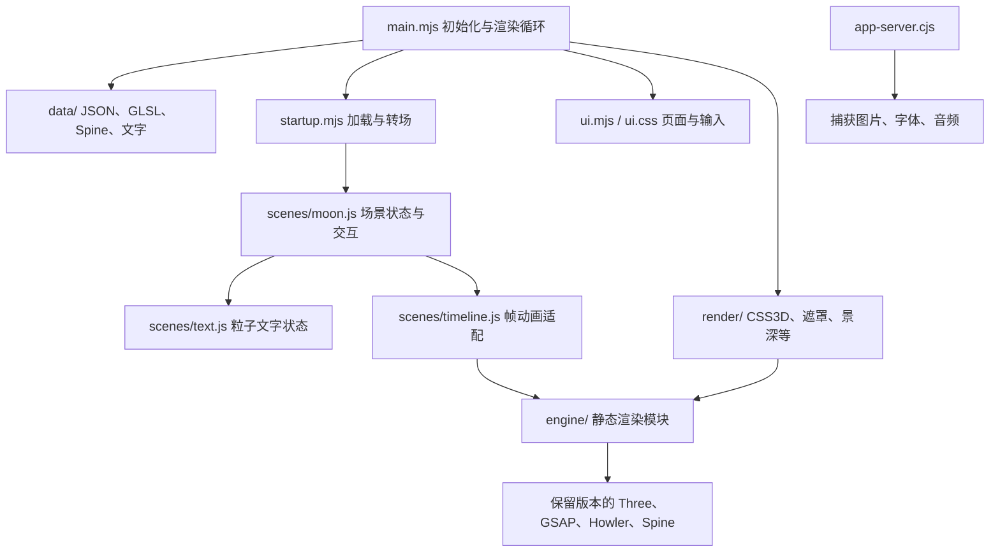
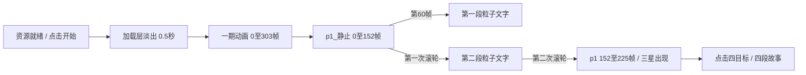

# 空月之歌：开场与月亮首屏重构

## 运行与范围

`npm start` 启动重构应用，地址为 http://127.0.0.1:4174。
本阶段实现桌面横屏中文的加载界面、开场、两段引导文字、月亮与三颗星星、
四段点击故事、鼠标提示、音乐开关及简介弹窗。默认刷新重新体验，
`?keepProgress` 使用保存的四目标访问记录。

账号登录、外部分享服务、后续章节及手机专用排版不在本阶段实现范围内。
`npm run start:reference` 在4173启动原业务包回放，供研究与对照；
它不是默认页面，也不是本次重构的实现。

## 模块关系与复用边界



应用入口、UI、加载转场、场景控制器、粒子/文字插件、六个渲染修饰器与CSS3D
使用具名模块和显式依赖。运行页面不请求原 `index/styles` 业务包、Vue或原页面入口。
服务端也拒绝通过 `/local-assets/` 读取原JS、HTML、CSS和JSON。

原美术素材、中文字体、GLSL、Spine骨骼与关键帧数值保留。离线工具将场景数据拆成
JSON、GLSL和纹理文件，将原渲染包恢复成59个静态ES模块，去除工厂注册与chunk运行时。
这些底层模块内部仍保留编译后的局部变量名；不是全部手写重实现。
第三方库保留捕获版本，Three.js含原渲染器的 `tick/afterRender` 扩展，不能直接换成
普通r130分发版。详细来源与边界见 `app/engine/PROVENANCE.md`，数据见 `app/data/README.md`。

`npm run extract` 可从仓库的捕获包重新生成引擎和数据，浏览器不执行这一步。
运行仍依赖 `projects/` 下的原二进制素材和 `url_mapping.json`，并通过
`replay/resource-map.js` 建立静态资源表。仅复制 `app/` 不足以运行。
174项原图片加载清单被保留以维持加载进度语义，其中含后续章节和手机素材；
这些素材加载不代表后续页面已经实现。

## 帧序列与文字



原帧时间轴默认30FPS。开场303帧名义10.1秒，随后152帧约5.067秒。
粒子文字40帧、速度0.75，名义约1.778秒。揭示三星的73帧约2.433秒。
引擎保留原低帧率delta限制；真实墙钟时间取决于设备性能。
这些时长不包含资源下载和用户阅读停留。

中文文字来自原国际化资源，保留标点、换行与原 `fontLink` 字体。
字体注册完成后才创建文字纹理，防止浏览器替代字体进入缓存。
首屏四段故事使用原中文纹理/Spine数据；简介使用完整原文及对应装饰图。
简介打开期间暂停场景tick/render，关闭开始时恢复；RAF与DOM动效继续运行。
页面隐藏时也暂停场景；恢复沿用原引擎的delta限制，不重置时钟。

## 验证

```bash
npm test
npm run verify:visual
npm run verify:browser
npm run verify:ui
npm run verify:startup
npm run verify:introduction
npm run verify:engine
npm run verify:live
```

自动测试覆盖转场可重入、帧调用与顺序、滚轮防重入、故事开关、访问记录、
字体初始化、视口/DPR、UI可见性、CSS动画时钟、数据提取、渲染模块提取和静态HTTP服务。

`scripts/verify-reconstruction.cjs` 使用同一Chrome的两个隔离上下文：
参考端保留捕获资源的原始URL和字节，另一个上下文运行重构应用。
仅测试环境同步Date、performance和60Hz RAF，按发射器UUID固定粒子随机数；
CSS动画使用各自出生时间，而不是页面全局经过时间。
Howler零时长fade在冻结时钟下的0/0情况由双方相同测试适配处理。
这些对称钩子会改变测试执行环境，但不改写磁盘参考包或截图。

默认1200×660/DPR1和1920×1080/DPR2，每个尺寸15个检查点：
加载、开场起点、0.1/0.25/0.5/2/5/10秒、两段提示、三星和四段故事。
逐像素报告同时记录真实时间轴帧、文字状态、画布尺寸和布局。
故事像素采集调用场景方法以固定时刻；它不能单独证明DOM点击入口有效。

`scripts/reconstruction-smoke.cjs` 补充正常时钟的真实输入：
点击开始、滚轮推进、实际点击四个移动CSS3D目标并在画布关闭故事，
验证音乐的实际mute状态、简介打开关闭与热点隔离，继续滚动仍停留首屏。
原业务包请求、外部请求、控制台错误、浏览器异常、资源缺失及未捕获拒绝均使验收失败。

`verify:ui` 验证简介250ms进入、180ms退出、Tab/Shift+Tab包含、键盘/鼠标背景隔离
和关闭后的焦点恢复。`verify:startup` 模拟字体/WebGL启动失败，并验证字体恢复后的重新加载。
`verify:introduction` 单独对照简介的完整文字、排版及过渡；参考端补全捕获缺失的
官方 `popup_bg.eef4a833..png`，来源记录于 `app/ui-assets/README.md`。

`app/engine/verify.browser.cjs` 独立比较原工厂与重写算法：粒子Float32缓冲、
中文文字RGBA纹理、123次摆动更新、CSS3D变换、两帧五遍景深和遮罩渲染状态。
`verify:live` 只读比较原站12个关键视觉源文件的SHA256。

浏览器工具优先使用项目依赖，或通过 `BROWSER_MODULES` 指定Playwright/pngjs位置；
`CHROME_PATH` 指定Chrome路径，`RECONSTRUCTION_URL` 指定重构页地址。
视觉脚本兼容旧 `RECON_URL`，还支持JSON数组 `RECON_VIEWPORTS` 及输出目录 `RECON_OUTPUT`。
`RECON_LOADING_CHECK=1 RECON_OUTPUT=artifacts/loading-progress npm run verify:visual`
检查0、25、25.5、75、75.5、100六种进度；`RECON_QUICK=three-stars` 保留真实前序输入，
在三星处结束，用于提示动效的定点回归。所有模式对任何不同RGB像素均判失败，没有加载页容差例外。
主要报告为 `artifacts/reconstruction/report.json`、`artifacts/reconstruction-smoke/report.json`
和 `artifacts/live-source.json`。旧 `artifacts/visual/` 是回放版本的历史报告，不能作为本次验收。

## 本次结果

2026-10-11 的默认Chrome/GPU复验结果：

- 自动测试48项通过；正常时钟的真实操作、简介键盘/时点回归和初始化失败重试均通过。
- 1200×660/DPR1和1920×1080/DPR2，主流程30帧中23帧零差。
  七个加载/淡出检查点仍有5至41个像素、最大一个色阶差，因此主流程严格像素验收失败。
  0.5秒后开场、两段提示、三星与四段故事均零差，全部记录的时间轴、画布和视口一致。
- 简介另行两尺寸共18帧，进入、静止、退出的完整视口全部零差；场景暂停/恢复时点相同。
- 六个静态加载进度中四帧仍有最大一个色阶差，扇形路径、数值文字和时钟相同。
- 真实开场至可交互提示约15.72秒。四目标均经实际鼠标点击/画布关闭；继续滚动留在首屏。
  本地没有控制台错误、页面异常、失败/缺失资源或原业务包/外网请求。
- 原站12个关键视觉源文件SHA256核对一致；原端活动结束错误`-500012`单独记录，未改参考业务包。

早期灰度差的诊断记录在 `artifacts/engine-loading-diagnostic/` 及
`artifacts/engine-loading-literals/`；保留真实失败，不用CPU栅格测试替代默认GPU结论。
截图、报告和捕获大素材不提交到Git，可用上面的命令重新生成。
