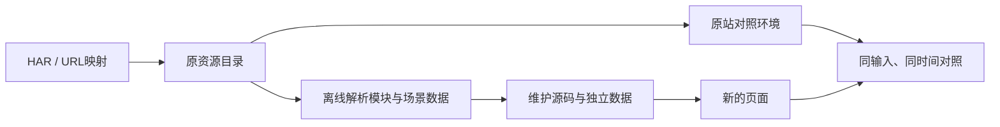
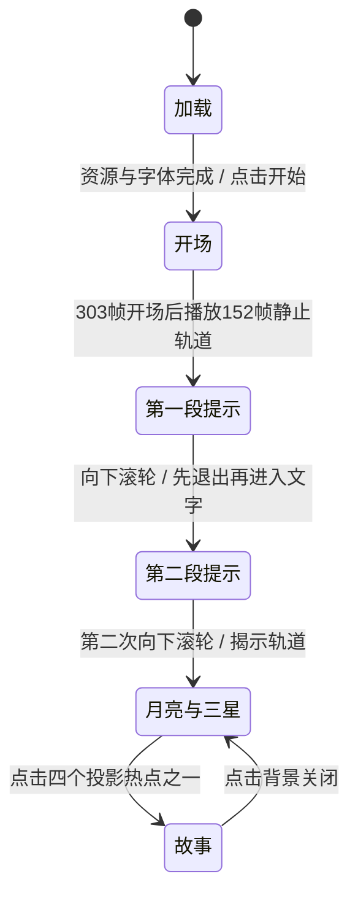

# 从 HAR 资源到可维护的月亮首屏

这份记录解释本项目实际做过的分析、重构和验证，以及每一步能证明什么。对应范围是「空月之歌」桌面横屏中文的加载、开场、月亮与三颗星星首屏。源码职责和复用入口见 [modules.md](modules.md)，当前验收结果见 [phase-one.md](phase-one.md)。

## 1. 起点：HAR 提供了什么，没有提供什么

接手时，仓库已经包含你提取的 `projects/ys.mihoyo.com/` 资源目录、URL 映射和实验页面。我没有重新完成最初那次人工抓包；已有的 `har_extractor.py` 也是仓库原有工具。

HAR 是网络请求与响应的记录，不是源代码工程。它能告诉我们入口 URL、资源地址、MIME、请求方法，以及被保存下来的响应内容。它通常不能直接提供原模块名、TypeScript 类型、组件边界、场景状态机、构建配置或开发者注释。

原提取器的具体行为也有区别：GET 静态文件是根据 HAR 中的 URL 重新下载；POST / JSON API 使用 HAR 保存的响应文本。因此，不能仅凭“文件来自 HAR”就认定静态文件仍是抓包那一刻的版本。我后来对线上 12 个关键视觉源文件做 SHA256 核对，确认这些文件与本地来源一致。这个核对不代表全部资源或服务行为都没有变化。

首先需要建立三种材料之间的关系：



`Oracle` 在这里指参考实现。它用于回答“原站在这个输入和时间点做了什么”，不能用它本身冒充新实现。

## 2. 先让参考页面可以研究

最初先处理原资源的本地回放：精确 URL 映射、动态公共路径、语言与字体地址、音视频 Range 请求，以及捕获中缺失的非视觉日志接口。活动已经结束，原账号接口会返回 `-500012`；这类服务状态需要与画面错误区分开。

这一阶段运行的是原业务包，价值是建立可观察的参考页面。它还没有满足“可读源码重构”。你指出不能只运行给定代码后，默认入口改成了独立实现；参考回放留在 `replay/`，只用于对照。

最终的新页面入口是 `app/main.mjs`。它不载入原 `index/styles` 业务 chunk、Vue、账号 SDK 或原页面入口。`app-server.cjs` 也拒绝通过素材路径把原 JS、HTML、CSS 和 JSON 当作运行素材发给新页面。

## 3. 找出数据、渲染器和业务流程的边界

分析时先看 URL 映射、入口脚本和 chunk 注册方式，再从模块工厂的依赖关系定位渲染与数据。CodeGraph 索引用于查模块、符号和调用路径；它是导航工具，推断仍要由实际代码和浏览器行为验证。

没有把所有混淆文件统一格式化后就称作逆向完成。实际分成三类处理：

| 材料 | 处理方式 | 原因 |
| --- | --- | --- |
| 图片、字体、音频、GLSL、Spine、帧轨道 | 保留内容，拆成具名文件和 JSON | 美术字节和数学参数本身就是画面依据，重新估计会引入误差 |
| 渲染核心 | 恢复模块依赖，再逐步整理维护入口 | 需要保留原采样、缓冲、精度和事件协议，同时消除 chunk 注册依赖 |
| 页面流程、UI、交互、插件、修饰器 | 按观察到的协议独立重写 | 原全局应用状态和业务 SDK 不适合作为这个首屏的维护基础 |

### 数据怎么提出来

`tools/extract-scene.cjs` 离线读取业务 chunk 的工厂注册表。它只允许明确的数据注册模块和纯资源导出，不启动原页面业务入口。

场景布局来自模块 `50440`，轨道来自 `1398`，图片/Spine 注册来自 `20444`，材质来自 `1924`。提取时保留首阶段的五个场景和九条轨道，移除 UI 合成中后续章节的平面；留下来的节点变换和关键帧数值不重新估算。

材质初始化原本会创建 Three 对象。离线阶段用记录型构造器保存 `{ $type, args }`，运行时由 `createShaderSetting()` 恢复 Vector、Color、Matrix、渐变和 ShaderMaterial。GLSL 单独保存，内嵌 base64 纹理恢复为二进制，中文从国际化资源读取，字体使用原 `fontLink`。

这样，修改中文、理解场景层级或检查一条轨道时，不再需要在整个业务 bundle 中找字符串。174 项原图片加载清单仍保留其进度语义，包含部分后续/移动素材；加载了这些图片不等于实现了对应章节。

### 渲染模块怎么恢复

`tools/extract-engine.cjs` 从 vendor 模块 `93823` 中定位内部 64 个工厂。五项库依赖适配到 `vendor/libraries.js`，其余恢复为 59 个静态 ES 模块，模块 ID 与源包 SHA256 记录在 `extraction.json`。

转换必须理解作用域。例如：

```js
function factory(module, exports, require) {
  const actualDependency = require(4);
  function local(require) { return require(4); }
}
```

第一处 `require` 是工厂依赖，第二处是局部参数。直接替换文本会改变第二个函数。当前提取器用 Babel 的 Binding identity 区分它们，并用实际 ESM 执行测试覆盖块级 `let`、`catch (exports)`、命名函数表达式的递归绑定、live export 和循环依赖。不是只检查输出字符串“看起来像 import”。

原始恢复结果现在写到 `artifacts/reference-engine/`。维护源码在 `app/engine/renderer/`，提取器禁止输出到这棵目录或覆盖它的父目录，符号链接也不能绕过这项限制。否则再次执行提取会把人工命名和解码修复抹掉。

## 4. 从原行为整理出可读的运行模型

首屏可以理解为三层：控制器决定下一步，时间轴执行帧采样，渲染/UI 显示结果。



`MoonSceneController` 管理这些状态、重入保护、访问记录和提示顺序；`ParticleTextController` 管理文字进入/退出；`FrameTimelinePlayer` 把原回调式时间轴包装成可等待的接口。音效、存储、计时器和状态通知都通过依赖传入，单元测试可以检查真实顺序，而不必启动 WebGL。

开场保留：加载合成层淡出 0.5 秒，`一期动画` 0–303 帧，`p1_静止` 0–152 帧，第 60 帧触发第一段文字。默认 30 fps 不代表每台电脑的墙钟时间都完全固定：原播放器还会限制 delta，设备性能会影响实时播放。

UI 单独实现加载扇形、导航、鼠标提示、四热点、音频和完整简介。文字、标点和换行从原资源取值，装饰图使用原素材。这里的模块边界让“改交互”与“改 GLSL”有不同的维护入口。

## 5. WebGL 难点不是只有画一个月亮

画面由多个场景和离屏缓冲合成。需要同时恢复几何、材质 uniform、粒子数据、遮罩、景深、多遍绘制、帧轨道以及 DOM 与摄像机之间的关系。

保留捕获的 Three r130，是因为它还带 `tick` / `afterRender` 扩展。把它替换为普通同版本发行包，会影响依赖这些事件的 Spine、程序运动和 CSS3D。GSAP、CustomEase、Howler 等也保留捕获版本，避免在逆向时顺便改变 easing 和音频时序。

关键适配器写在 `app/render/` 和 `app/engine/plugins.js`：粒子缓冲、文字纹理、合成、遮罩、景深、摆动和 CSS3D 均有独立入口。实际遇到的一个布局问题是：2500×1080 美术画幅、视口 CSS 尺寸和乘 DPR 后的 WebGL 尺寸不是同一个量。把更宽的美术画幅传给 CSS3D，会把裁切偏移算两次；现在明确分开这些输入。

另一个问题是字体缓存：先生成文字纹理再等待字体，会把替代字体永久画进缓存。现在先等待真实字体注册，再初始化文字节点。

## 6. 可维护性整理实际改了什么

拆文件只是第一步。后续整理把 `THREEPlayer` 的编译构造器包装改成原生类、命名导入和有语义的参数/局部变量，拆开不必要的逗号语句。比如视口计算中的临时名称改为 `croppedWidth`、`renderScale`、`renderWidth`、`bufferWidth`，并在代码旁解释为什么要保留运算顺序。

`source-loader.js` 改成可直接阅读的 XHR、解码、原生 async 批处理与重试。`motion.js` 明确列出数字类型与轨道/片段构造器的对应关系；`engine-api.js` 直接聚合服务；`scene-data.js` 明确保留严格 ID 查询。

时间轴基类没有直接改成原生 class：尚未整理的派生构造器会通过 `BaseTimeline.call(this, options)` 初始化。它使用具名 function 和非枚举原型描述符，测试锁定这项兼容协议。motion 与 GroupTimeline 存在依赖环，所以构造器在工厂被调用时才读取，避免顶层表格提前读取未初始化的 ESM 绑定。

注释主要解释不能随意改的原因：字体缓存、CSS 动效出生时刻、简介退出时场景恢复、typed array 精度、时钟阈值和对象初始化顺序。README 链接模块职责与复用示例，不给每一行显而易见的赋值加说明。

这次审查也补了实际失败路径：

| 问题 | 修复及证据 |
| --- | --- |
| 浏览器拒绝 localStorage 访问/清除，启动提前失败 | 把存储变为可选依赖；单元与真实 Chrome 注入验证仍能进入首屏 |
| HTTP 200 的坏 PNG 解码失败，Promise 一直等待 | 监听 image.onerror，等待解码后再计进度，进入原一次重试；测试永久失败和第二次成功 |
| 全局 uniform 配置引用不存在的 `uniforms` 变量 | 写入当前材质 uniform 并共享播放器值；先复现 ReferenceError，再验证共享引用 |
| 原始提取覆盖手工修复 | 原始输出与维护目录分开；测试直接路径、父目录和符号链接保护 |

并非 59 个模块的内部语义都已经整理完成。其余采样器、文字内部工具和 Spine 扩展中仍有恢复后的编译形态。这些边界公开写在模块文档与 provenance 中；不能把它们整体算作第三方库，也不能宣称全部恢复到了原开发工程的质量。

## 7. 怎么验证像素和时间

采用三种互补证据：

1. **行为与数值测试**：状态推进、重入、访问记录、布局/DPR、时钟、几何 Float32/Uint16/Uint32、轨道缓存、模块转换及加载失败。
2. **原算法局部对照**：粒子 Float32、文字 RGBA、摆动与 CSS3D 数值。景深/遮罩局部检查比较渲染调用轨迹和状态，使用模拟 renderer，并不直接证明其 GPU 图像。部分适配器对照共享底层库，公共部分的错误可能在两端抵消。
3. **独立整页和真实输入**：原端运行捕获原 HTML/JS/CSS/数据，重构端运行新入口。默认 Chrome/GPU 在两种视口与 DPR 下比较整页；另用正常时钟实际点击、滚轮、音乐和简介，补上截图测试无法证明的输入入口。

整页截图同步 Date、performance、60 Hz RAF，并按发射器 UUID 固定随机序列。异步加载不同会消耗不同的全局随机数；只固定一个随机种子仍可能产生不同粒子。测试适配放在验证脚本里，不进入页面运行源码。

CSS 动画也有自己的起点。简介、提示或导航晚于页面出生，不能把所有 CSS 动画的 currentTime 都设成页面全局时间。验证器记录每个动画的出生时刻；UI 的双 RAF 给初始类独立的样式计算时点。加载数字向下取整，SVG 扇形仍用小数；保留未变化的文字节点和属性，减少无必要的合成层重绘。

还处理了两种测试环境问题：滚轮事件发送完成不代表 100 ms 防抖回调已经运行，需要两端进入文字退出状态后再推进虚拟帧；冻结时钟使 Howler 零时长淡出出现 0/0，验证器对双方作相同适配。参考磁盘资源没有因此被改写。

验收对任何不同 RGB 像素都判失败，同时保存时间轴、画布和视口状态。实际仍观察到早期加载/淡出少量像素、最大一个色阶的差异；相同原站之间的控制实验也出现同量级波动。绘制指令与独立 CPU 栅格一致，支持浏览器合成路径参与差异的推断，但不证明默认 GPU 已稳定零差。没有放宽容差，也没有用 CPU 结果替代正式结论。

当前数值和结果见 [phase-one.md](phase-one.md)。测试数量只说明执行了多少用例，不等于底层引擎全面正确，更不等于所有设备与任意时间点都像素一致。

## 8. 交付与复用

最后把实际运行需要的 104 份二进制素材打包到 `app/local-assets/`，保持原字节；静态构建只复制运行文件，项目子路径由构建工具处理。新页面启动/部署不需要原捕获目录，重新提取和原站对照仍需要它。

源码发布在 `codex/moon-reconstruction` 分支，GitHub Pages 从独立 `gh-pages` 产物分支发布，避免覆盖原仓库主分支。部署后还使用真实 Chrome 检查资源、字体、点击与音频，而不只检查首页 HTTP 200。部署步骤见 [deployment.md](deployment.md)。

按本项目的分工继续开发：改文字先看 `app/data/`；改流程看 `app/scenes/`；改 DOM 看 `app/ui.mjs` / `ui.css`；改合成看 `app/render/`；改资源加载看 `source-loader.js`；改几何、材质或场景装配看 `THREEPlayer`。模块复用的最小实例见 [modules.md](modules.md)。

可以复用这套“来源记录 → 可观察参考 → 依赖/数据边界 → 行为协议 → 可读实现 → 数值与整页对照”的方法。提取脚本中的模块 ID、允许列表和帧名称属于这份抓包版本，不能直接当作任意 HAR 的通用反编译器。
